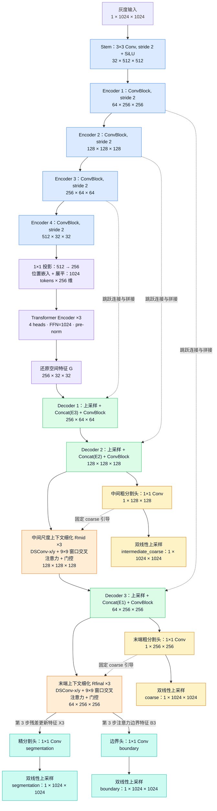
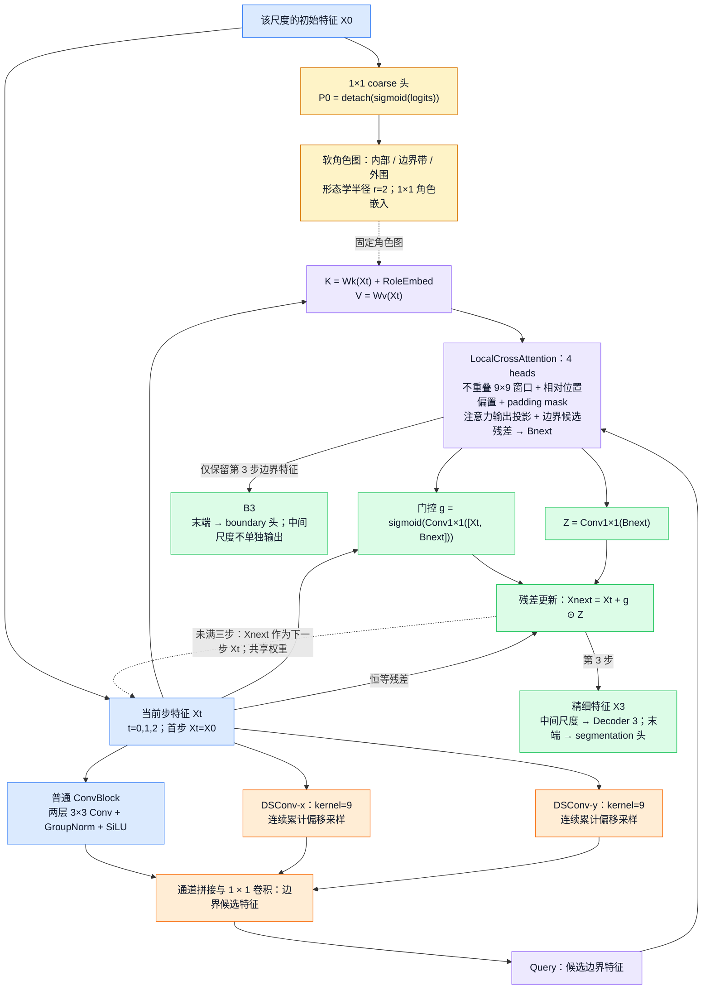

# 甲状腺超声结节分割、属性识别与描述生成

基于普通 CNN、动态蛇形卷积（DSConv）和上下文注意力的分割实现，以及属性识别与描述生成的后续研究方案。

> 状态：当前增强版视觉分割已实现：三层全局注意力、双尺度上下文、每尺度三步蛇形特征细化、超声增强及可选 TTA。本文第 2—5 节的结构图与尺寸按 `configs/full.json` 和当前代码同步；属性/风险分类、结构化事实及语言报告仍为未实现的后续规划。已通过功能测试和小批量冒烟验证，尚未完成正式训练或精度验收，不声称 Dice 提升。运行说明见 `SEGMENTATION.md`，早期验证记录见 `VALIDATION.md`。

## 1. 项目目标与范围

当前代码从甲状腺超声图像中完成结节分割与边界细化。长期目标是进一步预测有标注支持的影像属性及良恶性风险，将结果组织为逐病灶结构化事实，最终生成可核对的描述性文本；后半部分尚未实现。

核心研究问题：**结节内外上下文能否指导蛇形边界特征，使模型更准确地定位模糊边缘，同时保留真实的不规则轮廓？**

各模块分工：

| 模块 | 职责 |
| --- | --- |
| 普通 CNN | 提取内部纹理、区域特征和多尺度空间信息 |
| 全局 self-attention | 建立不同图像区域之间的长距离关联 |
| DSConv 边界分支 | 在两个解码尺度提取连续、弯曲的局部结构特征，每尺度迭代细化三步 |
| 局部 cross-attention | 在两个尺度的局部窗口内建模候选边界与邻近内外组织之间的关系 |
| 门控融合 | 根据语义信息调节边界特征的贡献 |
| 分割与边界头（已实现） | 输出精细分割、边界及两个尺度粗分割的 logits |
| 属性与风险头（规划） | 预测有标注支持的影像属性与风险 |
| 事实组装模块（规划） | 保留对象归属、来源、确定性和缺失状态 |
| 文本生成模块（规划） | 将允许报告的事实组织为描述，不自行补充诊断 |

初版以**每个输入样本对应一个已标注目标结节**为范围。存在多个结节时，需要检测/实例分割或目标提示，以及跨切面病灶匹配；单个二值语义 mask 不能自动解决实例归属。

### 超声与病理信息的边界

- 超声分支预测影像表现与风险，不将其直接表述为确诊病理结论。
- 病理亚型、显微镜下包膜/血管侵犯、送检淋巴结阳性数等，只有在已提供相应病理信息时才能进入综合描述。
- 病理良恶性可作为视觉分类监督，但测试时不能将真实病理标签作为视觉预测的输入。
- “考虑”“疑似”“恶性潜能未定”必须保留；恶性潜能未定不能强行编码为普通良性或恶性。
- 单张二维图不自动产生三个正交径线。没有可靠空间标定、对应多切面或外部测量时，尺寸保持未知。
- “甲状腺被膜”与“肿瘤包膜”是不同字段，不能混用。

## 2. 总体架构

视觉主体采用 **CNN 编码器—解码器式 U-Net**：最深层加入三层全局注意力，在解码 /8 和 /4 两个尺度加入普通卷积与蛇形卷积并行的上下文细化模块，每个模块共享权重迭代三步。文本生成器是后续独立模块，不属于当前模型前向。

### 2.1 当前已实现的完整分割网络

以下 Mermaid 图源就是本 README 预览/编译时使用的结构图。按增强版 `configs/full.json` 标注：输入 1024×1024、`base=64`、`heads=4`、`depth=3`、`multiscale_context=true`、`refinement_steps=3`。
张量尺寸为“通道数 × 高 × 宽”，省略 batch 维。虚线表示跳跃连接或 coarse 引导；四个输出均为 **logits**，不是已阈值化 mask。属性、风险及文本模块不混入已实现网络。



### 2.2 蛇形边界细化模块内部结构图

两个尺度都使用下图：中间尺度为 `C=128, H=W=128`，末端为 `C=64, H=W=256`。
`X0` 是该尺度进入细化模块前的特征，`Xt` 是第 t 步特征，执行 `t=0,1,2` 共三步。
粗分割由 X0 预测并在三步中保持不变；每步将上一步残差更新特征作为新输入，重新预测蛇形偏移。
**每个尺度内三步共享权重，两个尺度之间参数独立。**



### 2.3 两种注意力的分工

| 位置 | 关联对象 | 主要作用 |
| --- | --- | --- |
| /32 瓶颈，32×32 网格，全局 self-attention ×3 | 全部 1024 个 token | 建立区域与整体环境的联系 |
| /8 和 /4 两个尺度，每尺度细化三步中的局部 cross-attention | 同一 9×9 窗口的边界候选与组织特征 | 利用组织过渡信息修正边界 |

两张图直接使用本 README 中的 Mermaid 代码块渲染，不依赖外部 PNG；更新 Markdown 预览即可查看。
`docs/` 中的 PNG/SVG 是辅助导出图，不替代此处图源。当前 `ConvBlock` 是两组
`3×3 Conv + GroupNorm + SiLU`，编码块仅第一层卷积使用 stride 2。

### 2.4 后续扩展边界

属性/风险预测、逐病灶结构化事实、模板或条件文本生成、一致性核验保留为第 6—9 节的研究规划，
不属于图 2.1 的已实现推理链路。数据增强只发生在训练输入阶段；TTA 是模型外的可选推理策略。

## 3. 输入与特征尺寸

以当前增强版灰度图 `X: [B, 1, 1024, 1024]` 为输入；B 为 batch size。
encoder 总下采样率为 **32**，瓶颈为 **32×32、1024 tokens**，不是 64×64。

| 符号 | 张量尺寸 | 用途 |
| --- | --- | --- |
| Stem | `[B, 32, 512, 512]` | 首次下采样 |
| F1 | `[B, 64, 256, 256]` | 浅层细节；skip → Decoder 3 |
| F2 | `[B, 128, 128, 128]` | 局部纹理；skip → Decoder 2 |
| F3 | `[B, 256, 64, 64]` | 区域与形态；skip → Decoder 1 |
| F4 | `[B, 512, 32, 32]` | 深层语义 |
| T | `[B, 1024, 256]` | 1024 个 token，每个 256 维 |
| G | `[B, 256, 32, 32]` | 三层全局注意力后还原空间特征 |
| Decoder 1 | `[B, 256, 64, 64]` | 上采样 + F3 拼接后的解码特征 |
| U_mid、U_mid_refined | `[B, 128, 128, 128]` | Decoder 2 输出及中间三步细化结果 |
| P0_mid | `[B, 1, 128, 128]` | 中间尺度粗预测 sigmoid 后的角色图来源 |
| U、U_refined | `[B, 64, 256, 256]` | Decoder 3 输出及末端三步细化结果 |
| P0 | `[B, 1, 256, 256]` | 末端粗预测 sigmoid 后的角色图来源 |
| segmentation、boundary、coarse、intermediate_coarse | 各 `[B, 1, 1024, 1024]` | 模型返回的四个 logits 张量 |

输入预处理须同步作用于图像和 mask；mask 缩放采用最近邻插值。优先使用无测量点与文字叠加的原始帧，避免模型从人工标记中获取目标位置。调整分辨率时保留纵横比例及坐标映射，测量时恢复原始标定。

## 4. 普通 CNN 与 DSConv 的结合

共享 CNN 编码器，使用全局特征 G 和 F3、F2、F1 的跳跃连接逐级解码。
在 Decoder 2 输出处先执行中间尺度细化，再进入 Decoder 3；末端再执行一次三步细化。
不替换全部普通卷积。以下 U 表示任一尺度、任一步的当前特征。

$$
R=\operatorname{ConvBlock}(U)
$$

$$
S_x=\operatorname{DSConv}_x(U),\qquad S_y=\operatorname{DSConv}_y(U)
$$

$$
F_b=\operatorname{Conv}_{1\times1}\left([R,S_x,S_y]\right)
$$

`[·]` 表示通道拼接。各分支输出相同空间尺寸和通道数，拼接后从 3C 投影回 C；
中间尺度 C=128，末端 C=64。x/y 表示蛇形采样的初始展开方向，不表示采样始终局限于直线。

普通卷积负责块状区域与局部纹理；DSConv 提供连续变形采样的结构偏置。结节轮廓局部近似曲线，但整个结节并非管状结构，因此这是迁移假设，需要消融验证。DSConv 也可能响应血管壁、肌肉界面和伪边缘，不能单独视为结节边界检测器。

当前选择三步特征迭代方案，没有新增拓扑约束损失，也不保证采样链不自交或拓扑正确；
不能将该方案表述为 DSCNet 完整网络或显式轮廓跟踪的复现。

## 5. Attention 如何形成 patch 关联

### 5.1 全局 patch 自注意力

将 F4 投影到 256 通道，再展平 32×32 空间位置；可学习位置嵌入从 16×16 插值到该网格：

$$
T=\operatorname{Flatten}(\operatorname{Proj}(F_4))+E_{pos}
$$

$$
Q=TW_Q,\quad K=TW_K,\quad V=TW_V
$$

$$
A_{ij}=\operatorname{softmax}_{j}\left(\frac{q_i^Tk_j}{\sqrt d}\right),\qquad
t_i'=\sum_j A_{ij}v_j
$$

每个 token 是一个局部区域的 CNN 表征，感受野可以重叠。每层每个注意力头在概念上对应
一个 1024×1024 关系矩阵；`A[i,j]` 表示区域 i 更新特征时读取区域 j 的权重。
当前连续执行三层 Transformer Encoder，各层参数独立，4 个头、FFN 维度 1024、GELU、
pre-norm、dropout=0，最后还原为 G。全局层使用加性位置嵌入，没有局部窗口模块的相对位置偏置。

该模块负责长距离上下文，不承担精确像素边界恢复。注意力权重不是已确认的解剖关系；没有组织类别监督时，不能宣称某个 token 已被识别为血管或腺体。

### 5.2 粗预测构造局部区域角色

由 `P0 = sigmoid(coarse_head(U))` 产生粗预测，并在其分辨率上计算软形态学区域：

$$
w_{in}=\operatorname{Erode}_r(P_0)
$$

$$
w_{band}=\operatorname{Dilate}_r(P_0)-\operatorname{Erode}_r(P_0)
$$

$$
w_{out}=\operatorname{Dilate}_r(P_0)-P_0
$$

膨胀/腐蚀通过 max/min pooling 实现，数值裁剪到合法范围。三个权重是可重叠的几何提示，不是互斥组织类别；外部邻域不能直接称为正常甲状腺。将它们拼接后通过 1×1 卷积映射为角色嵌入 E_role。

当前两个尺度均取 r=2 个**各自特征网格像素**，对应的输入覆盖范围不同。
`detach_roles=true` 停止角色图反向梯度，但两个 coarse 头仍由辅助分割损失直接监督。
每个尺度的 P0 由初始特征预测，在三步内不更新。测试阶段始终使用预测 P0，不使用人工 mask 构造输入邻域。

### 5.3 局部边界—上下文交叉注意力

蛇形融合特征提供 Query，普通解码特征提供 Key/Value：

$$
q_i=W_qF_b(i),\qquad k_j=W_kU(j)+E_{role}(j),\qquad v_j=W_vU(j)
$$

$$
C_i=F_b(i)+W_o\left(\sum_{j\in\mathcal W(i)}
\operatorname{softmax}_j\left(\frac{q_i^Tk_j}{\sqrt d}+b_{ij}\right)v_j\right)
$$

上式省略多头拼接记号。当前使用 4 个头、**不重叠 9×9 特征窗口**；W(i) 是位置 i
所在的共享窗口，不是以每个像素为中心滑动的邻域。使用可学习相对位置偏置，补齐窗口时屏蔽
padding key；注意力输出经 1×1 投影后与候选边界特征残差相加。

这层注意力用于检验局部组织过渡信息是否有助于边界细化。全局 self-attention 已承担远距离关联，
128×128 和 256×256 两个细化尺度均不再建立完整的全局注意力矩阵。

### 5.4 门控融合

$$
g=\sigma\left(\operatorname{Conv}([U,C])\right)
$$

$$
U_{refined}=U+g\odot\operatorname{Proj}(C)
$$

保留 U 的残差通路，以免粗边界提示错误后无法恢复。门控抑制无关边缘，不应强制所有修正只能发生在粗预测边界带。

当前不是只执行一次上述更新，而是在每个尺度共享参数重复三步：

$$
(X_{t+1},B_{t+1})=\operatorname{Refine}_{\theta}(X_t,P_0),\qquad t=0,1,2
$$

返回 `(X3, B3)`。下一步以 Xnext 重新预测偏移；末端 segmentation 头读取 X3，boundary 头读取 B3。
两个尺度使用不同参数 θ。直接将上下文作为偏移预测器的额外输入
`offset = f(U, context, P0)` 仍未实现；当前偏移只由该步特征预测。

## 6. 已实现输出与规划中的多任务头

| 输出模块 | 特征来源 | 监督/输出 | 状态 |
| --- | --- | --- | --- |
| 中间粗分割头 | 中间细化前的 U_mid | `intermediate_coarse` logits；真值 mask 监督 | 已实现 |
| 末端粗分割头 | 末端细化前的 U | `coarse` logits；真值 mask 监督 | 已实现 |
| 精细分割头 | 末端第 3 步 X3 | `segmentation` logits；真值 mask 监督 | 已实现 |
| 边界辅助头 | 末端第 3 步 B3 | `boundary` logits；真值 mask 派生边界带监督 | 已实现 |
| 轮廓属性头 | 边界区域汇聚特征 | 规则性、清晰度等已有属性 | 未实现 |
| 内部属性头 | 结节内部汇聚特征 | 回声、组成等已有属性 | 未实现 |
| 风险分类头 | 内部、边界、外部汇聚特征 | 良恶性预测概率 | 未实现 |
| 几何测量模块 | mask、原始坐标及标定 | 有依据的尺寸/面积 | 未实现 |
| 元数据模块 | 检查记录 | 部位、切面、病灶编号 | 未实现 |

四个已实现头均为 1×1 卷积，其 logits 分别双线性上采样至输入尺寸后返回。
预测时对 segmentation logits 使用 sigmoid，恢复原图尺寸，再按阈值生成 mask。

以下区域池化和属性预测属于**未实现的研究设计**。精细预测 P 下采样至特征分辨率后进行软区域池化：

$$
z_{in}=\frac{\sum_{x,y}P(x,y)U_{refined}(x,y)}{\sum_{x,y}P(x,y)+\epsilon}
$$

由精细预测生成边界/外围权重，得到 z_boundary 和 z_outside。小区域或空预测须设有效性标记，不能将空池化向量解释为正常。

$$
\hat y_{shape}=h_{shape}(z_{boundary})
$$

$$
\hat y_{risk}=h_{risk}([z_{in},z_{boundary},z_{outside}])
$$

不同属性使用独立头：互斥类别用 softmax，可共存标签用 sigmoid。未标注属性使用缺失掩码，不参与对应损失。轮廓规则性与边界清晰度保持分离。

## 7. 结构化事实接口

本节是尚未实现的接口规划，不是当前模型的返回值。

视觉输出先经确定性的事实组装模块处理，再交给文本模块。每个结节使用唯一 `lesion_id`，每个字段保留值、来源、置信度及可用状态。

以下是虚构接口示例，不是对具体病例或上传图像的判断；其中置信度数值仅用于说明格式。

```json
{
  "patient_id": "example_001",
  "lesion_id": "R1",
  "site": {
    "value": "右叶",
    "source": "exam_metadata",
    "confidence": null,
    "status": "provided"
  },
  "shape": {
    "value": "不规则",
    "source": "model_prediction",
    "confidence": 0.88,
    "status": "reportable"
  },
  "margin_clarity": {
    "value": "欠清",
    "source": "model_prediction",
    "confidence": 0.84,
    "status": "reportable"
  },
  "size": {
    "value": null,
    "unit": "mm",
    "source": null,
    "status": "missing_calibration"
  },
  "histologic_subtype": {
    "value": null,
    "source": null,
    "status": "not_provided"
  }
}
```

是否允许报告，由验证集确定的阈值和校准策略决定，不直接套用本示例。低置信度、未提供、检查阴性是不同状态。

若接入已有病理结果，应新增独立命名空间并保留原始确定性，例如 `pathology.diagnosis`、`pathology.certainty`、`lymph_nodes.examined_count`、`lymph_nodes.positive_count`。同时保存证据或报告标识，不把外部病理结论伪装成图像预测。

## 8. 从标签到描述性文本

本节为后续方案，当前训练和预测入口不生成文本、属性标签或风险结论。

### 8.1 事实规划

按照“病灶编号—部位—大小—内部表现—轮廓与边界—其他已支持信息”排序。未知字段根据报告规范省略或明确写为未提供；不能自动补成阴性。

示例序列化输入：

```text
<病灶 R1>
<部位 右叶>
<轮廓 不规则>
<边界清晰度 欠清>
<尺寸 未知>
<病理类型 未提供>
```

### 8.2 模板基线与可训练解码器

先实现确定性模板，建立可核验基线。之后再训练“结构化事实 z → 医生描述 y”的编码器—解码器：

$$
H_z=\operatorname{TextEncoder}(z),\qquad
p(y_t)=\operatorname{TextDecoder}(y_{<t},H_z)
$$

文本解码器中的 cross-attention 读取事实 token，而不是重新判读图像。第一版不接入原始视觉 token，减少绕过结构化字段新增事实的机会。

上述虚构示例可组织为：

> 右叶见结节，轮廓不规则，边界欠清。

不应增加没有输入依据的尺寸、病理亚型或包膜侵犯。尺寸、数量、部位优先使用复制或槽位填充；描述性词语使用规范表达表。

### 8.3 输出核验

将生成文本重新解析为对象、属性和关系，核对：

- 是否出现未提供的新事实；
- 左右侧与病灶编号是否一致；
- 尺寸、单位、数量及阳性/送检比例是否一致；
- “疑似、考虑、未定、未知”等状态是否保留；
- 是否将风险预测写成病理确诊。

核验不通过时回退模板，并保留错误记录。自动核验器本身也需要评估，不能将其视为绝对可靠的事实判定器。

## 9. 数据组织与标签要求

当前分割链路读取 image、mask 与患者/中心划分信息，不读取 `label1.csv`；
病灶属性、风险、报告配对和多切面关联为后续任务的数据要求。

| 数据项 | 要求 |
| --- | --- |
| image、mask | 文件一一对应，坐标与尺寸一致 |
| patient_id | 用于患者级划分，阻止同患者跨集合泄漏 |
| lesion_id、view_id | 区分多病灶与多切面 |
| malignancy_label | 保存来源、确定性；未定病例另行处理 |
| attributes | 仅使用医生确认或可可靠提取的属性，并记录缺失掩码 |
| metadata | 部位、切面、设备、像素间距及原始坐标映射 |
| report | 与病灶或患者明确对应，区分超声报告与病理报告 |

同一患者左右侧病灶不能共享不匹配的病理标签。单张图不可直接绑定整份患者报告中的全部事实。缺少报告配对数据时，先完成属性预测与模板生成，不强行训练自由文本生成器。

如需患者级多切面融合，应先按 `lesion_id` 汇聚同一结节的特征/事实，再生成患者级描述；初版不假设此功能已经实现。

## 10. 损失与训练流程

### 10.1 当前分割训练

当前 `losses.py` 实际使用：

$$
\mathcal L=\mathcal L_{seg}
+0.4\frac{\mathcal L_{coarse}+\mathcal L_{mid}}{2}
+0.2\mathcal L_{boundary}
$$

各项均为 Dice+BCE，边界 BCE 的正样本权重按有效区域统计并裁剪到 `[1,20]`。
边界目标由真值 mask 通过形态学操作构造，半径为 2 个输入像素；padding 不参与损失。
中间 coarse 和末端 coarse 先取平均再乘 0.4，避免增加监督头后将粗分割权重翻倍。
关闭多尺度上下文时，仅使用末端 coarse 损失。没有属性、风险、文本或拓扑损失。

训练增强保留同步水平翻转、小角度旋转及对比度/亮度变化；增强版新增弹性形变、乘性散斑、
增益/深度衰减和局部亮斑。弹性形变对图像与 mask 使用同一坐标场，mask 最近邻采样；
强度类增强只作用于图像。这些操作在训练集 letterbox 前执行，验证/测试不使用随机增强。
新增增强由 `configs/full.json` 的 `augmentation` 控制，可逐项关闭。

```bash
python -m pip install -r requirements-seg.txt
python train.py --config configs/full.json --device cuda --batch-size 2
```

默认新实验目录为 `runs/full_enhanced`。上述命令把配置中的 batch size 16 覆盖为 2；
应按显存预算调整。未指定新参数的构造函数仍保留单层全局注意力、单尺度、一步细化，
以兼容旧 checkpoint；新结构需重新训练，旧实验续训请使用原运行目录保存的配置。

### 10.2 未来多任务训练方案（未实现）

后续视觉多任务损失可扩展为：

$$
\mathcal L_{vision}=\lambda_0\mathcal L_{coarse}
+\mathcal L_{seg}+\lambda_b\mathcal L_{edge}
+\lambda_a\mathcal L_{attr}+\lambda_c\mathcal L_{risk}
$$

- 分割：Dice + BCE，可同时监督粗、精预测。
- 边界：真值 mask 派生边界带，使用适当处理类别不平衡的 BCE/Dice。
- 属性：按任务使用 CE/BCE，并屏蔽缺失标签。
- 风险：仅在适用标签上计算分类损失。
- 基于距离的 Boundary Loss 可作为后续独立消融项，不等同于边缘辅助头损失。

文本部分：

$$
\mathcal L_{text}=-\sum_t\log p(y_t\mid y_{<t},z)
$$

| 阶段 | 训练内容 | 验证重点 |
| --- | --- | --- |
| A | CNN、普通解码器、分割头 | 稳定分割基线 |
| B | 加入全局 attention、DSConv、局部 attention 与门控，逐项消融 | 边界改进是否真实 |
| C | 加入属性与风险头 | 多任务收益及负迁移 |
| D | 人工核验事实与描述配对训练文本模块 | 正确事实能否准确表达 |
| E | 接入视觉预测，评估完整链路 | 错误传播、漏报与无依据新增 |

文本和视觉初期分开训练，不让语言损失穿过离散标签直接更新视觉模块。接入预测事实时使用独立集或 out-of-fold 预测；不能以错误输入搭配矛盾的正确报告，迫使生成器凭空纠错。应同步事实与目标文本，或使用明确标注的缺失/不确定性扰动训练。

强化学习仅作为后续可选阶段。若采用奖励，优先考虑事实覆盖、对象关系、数值一致性和无依据新增惩罚，不单独优化语言相似度。固定数值与部位优先通过规则约束处理。

## 11. 评估与消融

### 11.1 当前分割评估与 TTA

`evaluate.py` 与 `predict.py` 默认单尺度、无翻转。可显式启用：

```bash
python evaluate.py --checkpoint runs/full_enhanced/best.pt --split val --device cuda \
  --tta-flip --tta-scales 0.75 1 1.25 --out artifacts/val_tta
python predict.py --checkpoint runs/full_enhanced/best.pt --input data/centre_YY/images \
  --device cuda --tta-flip --tta-scales 0.75 1 1.25 --out artifacts/predictions_tta
```

先将翻转预测翻回，再将不同尺度 sigmoid 概率恢复到基础输入网格取平均，最后还原原图尺寸；
不平均 logits 或二值 mask。三尺度加水平翻转是六次前向，不是免费提升。
TTA 和阈值需在验证集确定后固定，是否提升 Dice 须实测；训练期验证默认关闭 TTA。

### 11.2 指标与后续消融

当前实现仅覆盖分割指标、按中心汇总及患者级 Dice bootstrap；属性、风险和文本指标仍为规划。

| 层级 | 指标与检查 |
| --- | --- |
| 分割 | Dice、IoU、HD95、Boundary F1/Surface Dice；声明距离单位和容差 |
| 边界困难病例 | 模糊边界、小结节、靠近腺体边缘等分层结果 |
| 属性 | 每属性 precision/recall/F1，缺失标签不参与计分 |
| 风险 | AUROC、敏感度、特异度、校准；阈值由验证集确定 |
| 文本 | 字段覆盖、事实正确率、侧别/数量错误、确定性保持、无依据新增率 |
| 完整链路 | 从图像到文本的事实正确率，并与人工真值字段输入对照 |
| 资源 | 参数量、显存、训练/推理耗时 |

患者级划分，固定测试集，使用多随机种子或患者级置信区间。BLEU/ROUGE 可作补充，不能替代事实评估。

建议按以下对照区分模块贡献：

| 实验 | 目的 |
| --- | --- |
| 普通 CNN/U-Net | 基线 |
| 基线 + 全局注意力 | 远距离 patch 关联收益 |
| 等参数量普通边界分支 | 排除容量增加的影响 |
| DSConv 边界分支 | 连续采样的贡献 |
| 一般可变形卷积分支 | 与非连续约束采样对比 |
| DSConv + 局部上下文注意力/门控 | 上下文对边界的增益 |
| 全局 depth=1 / 2 / 3 | 区分注意力深度与计算开销的影响 |
| 仅末端上下文 / 双尺度上下文 | 检验 128×128 中间尺度提前注入边界信息的收益 |
| refinement_steps=1 / 2 / 3 | 检验共享权重迭代细化的收益与开销 |
| 基础增强 / 新增超声增强 | 区分结构变化与数据增强的贡献 |
| 无 TTA / 翻转 / 多尺度加翻转 | 在相同 checkpoint 下比较精度与推理耗时 |
| 加属性监督 | 描述标签是否改善边界表征 |
| 上下文引导偏移 | 比仅特征门控是否进一步提升 |

算子对照保持其他设置、边界监督与训练预算一致；损失函数另做消融。采样点与 attention 可视化用于定位失败原因，不能单凭可视化证明临床可解释性。

## 12. 当前代码模块与后续工作

已实现文件与未实现的规划接口分开列出，不能将研究目标理解为现有功能。

| 模块 | 内容 | 状态 |
| --- | --- | --- |
| `data/prepare.py` | 图像/mask 审计、患者组划分与重复图像检查 | 已实现 |
| `data/dataset.py` | 图像/mask 配对、letterbox、同步变换与原图恢复 | 已实现 |
| `data/augmentation.py` | 弹性形变、散斑、增益/衰减、局部亮斑 | 已实现 |
| `models/encoder.py` | 多尺度 CNN、skip 与 decoder | 已实现 |
| `models/global_attention.py` | 深层 token 化与多层 self-attention | 已实现 |
| `models/dsconv.py` | 连续累计偏移蛇形采样 | 已实现 |
| `models/context_refinement.py` | 区域角色、窗口 cross-attention、门控与共享权重迭代 | 已实现 |
| `models/unet.py` | 组合全局注意力、双尺度细化与四个输出分支 | 已实现 |
| `models/heads.py` | 末端 coarse、segmentation 和 boundary 头；中间头定义于 unet | 已实现 |
| `losses.py` | 双 coarse 平均监督及分割/边界损失 | 已实现 |
| `engine.py`、`train.py` | 数据加载、训练、验证、checkpoint | 已实现 |
| `inference.py` | 可选翻转/多尺度概率 TTA | 已实现 |
| `evaluate.py`、`predict.py` | 原图尺寸评估、mask/概率图/叠加图导出 | 已实现 |
| `evaluation/metrics.py` | 分割/边界指标与患者级 bootstrap | 已实现 |
| `tests/` | 算子、梯度、增强、TTA、兼容性等 24 项测试 | 已实现 |
| `report/schema.py` | 字段定义、来源与状态 | 未实现 |
| `report/assembler.py` | 逐病灶事实组装与报告字段筛选 | 未实现 |
| `report/generator.py` | 模板或条件文本解码器 | 未实现 |
| `report/validator.py` | 事实一致性核验 | 未实现 |

- [x] 实现图像/mask 审计、患者组划分与普通 CNN 分割基线代码。
- [x] 实现三层全局 attention、双尺度上下文与三步共享权重细化。
- [x] 接入超声增强、可选 TTA，完成 24 项测试及小批量训练/评估/预测冒烟验证。
- [ ] 完成正式训练、多 seed 与主要消融，验证收益和资源开销。
- [ ] 额外核查跨中心患者身份、病灶/切面配对及属性标签语义。
- [ ] 建立模板报告基线。
- [ ] 加入属性与风险头，校准概率和报告阈值。
- [ ] 固定结构化事实接口及核验规则。
- [ ] 有足够配对文本后训练生成器，并评估完整链路。
- [ ] 只有基础结果成立后，再探索上下文引导偏移与强化学习。

## 13. 参考研究与代码

以下工作提供组件和实验思路，不代表它们已验证本文完整组合。不同数据集的指标不能直接横向比较。

| 工作 | 可借鉴内容 | 论文/代码 |
| --- | --- | --- |
| DSCNet，ICCV 2023 | 连续偏移蛇形采样、管状结构特征 | [论文](https://openaccess.thecvf.com/content/ICCV2023/html/Qi_Dynamic_Snake_Convolution_Based_on_Topological_Geometric_Constraints_for_Tubular_ICCV_2023_paper.html) · [代码](https://github.com/YaoleiQi/DSCNet) |
| TransUNet，2021 | CNN 特征 token 化、全局上下文与 U-Net 解码 | [论文](https://arxiv.org/abs/2102.04306) |
| Gated-SCNN，ICCV 2019 | 语义流对形状流的门控 | [论文](https://openaccess.thecvf.com/content_ICCV_2019/html/Takikawa_Gated-SCNN_Gated_Shape_CNNs_for_Semantic_Segmentation_ICCV_2019_paper.html) |
| BPAT-UNet，2023 | 甲状腺结节边界监督 | [论文](https://pubmed.ncbi.nlm.nih.gov/37244233/) · [代码](https://github.com/ccjcv/BPAT-UNet) |
| TRFE+，2023 | 甲状腺腺体区域先验 | [论文](https://doi.org/10.1016/j.compbiomed.2022.106389) · [代码](https://github.com/haifangong/TRFE-Net-for-thyroid-nodule-segmentation) |
| Spatial Prior-Guided Dual-Path Network，2025 | 腺体先验与局部特征融合 | [论文](https://pubmed.ncbi.nlm.nih.gov/40794498/) |
| Boundary Loss，MIDL 2019 | 轮廓距离与区域损失互补 | [论文](https://proceedings.mlr.press/v102/kervadec19a.html) · [代码](https://github.com/LIVIAETS/boundary-loss) |
| Deep Snake，CVPR 2020 | 显式轮廓迭代变形；不同于 DSConv | [论文](https://openaccess.thecvf.com/content_CVPR_2020/html/Peng_Deep_Snake_for_Real-Time_Instance_Segmentation_CVPR_2020_paper.html) |
| Concept Bottleneck Models，ICML 2020 | 可检查的中间语义概念 | [论文](https://proceedings.mlr.press/v119/koh20a.html) |
| R2Gen，EMNLP 2020 | 条件报告生成，原实验为胸片 | [论文](https://aclanthology.org/2020.emnlp-main.112/) |
| RadGraph reward，Findings of EMNLP 2022 | 实体关系奖励与报告事实一致性 | [论文](https://aclanthology.org/2022.findings-emnlp.319/) |
| TAZD-Net，2026 | 结节内部、环带与上下文联合建模 | [论文](https://link.springer.com/article/10.1007/s44163-026-02434-2) |

已有 [YOLO-based thyroid ultrasound for assisted diagnosis（2024）](https://doi.org/10.1088/1742-6596/2858/1/012011) 将蛇形卷积用于甲状腺超声检测。因此，“CNN 与蛇形卷积混用”或“首次用于甲状腺超声”不应直接作为创新声明；应围绕上下文指导边界建模、属性监督贡献及严格消融形成证据。

病理信息边界可参考美国甲状腺协会关于[甲状腺细胞病理与组织病理质量保证](https://www.thyroid.org/professionals/laboratory-services-library/quality-assurance-cytopathology/)的说明。

