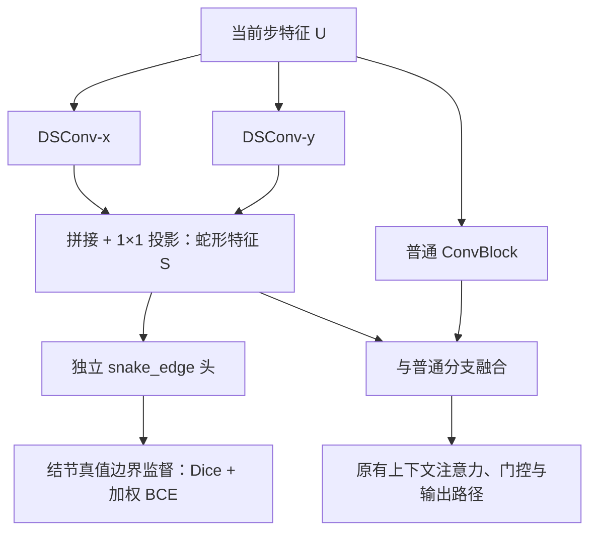

# 下一步更新计划：让 DSConv 更关注结节边界

更新日期：2026-11-25。

**状态：待实施。本文是下一轮改动计划，不代表相关功能已写入模型，也不代表已验证精度提升。**

## 1. 更新目标与当前基础

目标不是让 DSConv 响应所有图像强边缘，而是让其特征与采样偏移更有针对性地服务于
**已标注目标结节的边界分割**，减少对血管壁、肌肉界面及伪边缘的误响应。

当前增强配置 `configs/full.json` 已包含：

- 三层全局注意力。
- /8 与 /4 两个尺度的上下文细化。
- 每个尺度三步共享权重细化。
- 两个 coarse 头、最终 segmentation 头与 boundary 头。
- 超声数据增强及可选翻转/多尺度 TTA。

当前 DSConv 已能通过融合后的 boundary 损失接收梯度，但该损失也训练普通卷积分支与
注意力模块。因此，最终边界预测良好，不足以单独证明蛇形分支学到了目标边界。
当前偏移由 `self.offset(x)` 预测，coarse 主要进入后续注意力，还没有直接参与偏移预测。

三步迭代本身不增加新的边界监督目标，不能等同于显式轮廓追踪。

## 2. 实施顺序

| 顺序 | 更新项 | 状态 | 验证目标 |
| --- | --- | --- | --- |
| P0 | 固定当前增强版基线及实验配置 | 待进行 | 建立可比较的起点 |
| P1 | 蛇形分支独立边界监督 | 待实现，优先 | 检验直接监督是否有助于蛇形特征学习 |
| P2 | 粗分割引导偏移预测 | P1 验证后再实施 | 检验目标位置提示是否改善采样与最终边界 |
| P3 | 可选软边界门控 | 独立消融 | 检验边界区域加权是否有效及是否损伤召回 |

不要一次叠加所有改动。P1、P2、P3 分别配置开关，关闭时保留现有行为。
新增拓扑损失不属于本轮计划。

## 3. P1：蛇形分支独立边界监督

### 3.1 结构变化

在蛇形特征与普通卷积分支融合之前，增加一个只读取 DSConv-x/y 输出的辅助边界头：

这是拟议结构。若独立投影同时进入主干，需用“相同新结构、辅助损失权重为 0”的实验，
区分结构变化与直接监督的贡献。也可先将新投影仅用于辅助头，保留现有主干融合不变，
以尽量隔离监督因素；实施时应明确记录所选方案。

- [ ] 两个尺度各增加独立的蛇形边界辅助头。
- [ ] 辅助头不能直接读取普通卷积分支或注意力融合结果，避免绕开蛇形特征。
- [ ] 第一版仅监督每个尺度第 3 步的蛇形特征，不同时增加所有迭代步的深监督。
- [ ] 保留原 segmentation、coarse、intermediate_coarse、boundary 的语义和监督。
- [ ] 明确新增辅助 logits 的名称、空间尺寸及训练/推理返回约定。

### 3.2 边界目标与损失

从结节真值 mask Y 构造目标边界带：

\[
E_{\mathrm{gt}}=\operatorname{Dilate}(Y)-\operatorname{Erode}(Y)
\]

监督目标不是 Sobel 等图像梯度算子检测出的全部强边缘。在标注可靠的前提下，不属于目标
结节边界的血管壁、肌肉界面等位置，作为辅助边界任务的负样本参与训练。

\[
L_s=\operatorname{DiceLoss}(\hat E_s,E_{\mathrm{gt}})
+\operatorname{WeightedBCE}(\hat E_s,E_{\mathrm{gt}})
\]

两个尺度的辅助损失取平均，再以单独权重加入现有损失：

\[
L_{\mathrm{total}}=L_{\mathrm{existing}}
+\lambda_s\frac{L_{s,\mathrm{mid}}+L_{s,\mathrm{final}}}{2}
\]

- [ ] 新增可配置的辅助损失权重；初始数值通过验证实验确定，不预设为最优值。
- [ ] 避免因尺度或迭代步数增加，使辅助损失总权重自动翻倍。
- [ ] 边界带宽与监督网格匹配，明确使用输入像素单位还是特征像素单位。
- [ ] 核查小结节和细边界在缩放后是否消失；不得直接复用不合适的薄边界目标。
- [ ] 屏蔽 letterbox padding，正确处理空 mask、空边界和类别不平衡。
- [ ] 区分 logits 与 sigmoid 概率，避免对 BCEWithLogits 重复 sigmoid。

## 4. P2：粗分割引导偏移预测

### 4.1 拟议接口

当前偏移预测仅使用当前步特征 U。拟增加同尺度粗概率 P0 及预测边界带 A：

\[
A=\operatorname{Dilate}(P_0)-\operatorname{Erode}(P_0)
\]

\[
\Delta=f_{\mathrm{offset}}\left(
[U,\operatorname{stopgrad}(P_0),\operatorname{stopgrad}(A)]\right)
\]

**偏移预测可以读取额外上下文，但 grid_sample 仍从完整特征 U 采样。**
不要直接裁掉边界外区域，也不要将拼入的概率通道误当作待聚合的视觉特征。

- [ ] 将“被采样特征”与“偏移预测上下文”分开传入 DSConv。
- [ ] 初版对预测 P0/A 停止梯度，保持 coarse 头由已有辅助分割损失训练。
- [ ] 同一尺度的三步沿用初始 coarse 提示，当前步 U 随迭代更新。
- [ ] 保留中心零偏移、两侧累计偏移、偏移范围限制和混合精度处理。
- [ ] 保持旧调用方式及关闭新增功能时的 checkpoint 兼容性。

### 4.2 数据使用边界

训练和推理均使用模型预测的 P0/A；**真实 mask 只能用于监督，不能作为偏移预测器输入**。
不得采用训练时真值引导、推理时预测引导却不披露两者差异的实现。

## 5. P3：可选软边界门控

不将采样或特征硬限制在二值粗边界内，避免粗分割遗漏区域失去恢复机会。
可对蛇形特征尝试保留底值的软门控：

\[
S_{\mathrm{guided}}=S\odot[\epsilon+(1-\epsilon)A],\qquad 0<\epsilon<1
\]

- [ ] 作为独立开关实施，而不是与 P2 强制绑定。
- [ ] 对门控底值、边界带宽和粗预测质量做敏感性分析。
- [ ] 保留普通卷积和主干残差路径，检查是否损伤低置信度边界及小结节召回。
- [ ] 固定门控与辅助边界头的前后位置，并在文档、结构图和实验配置中写清楚。

该方案只是候选实验，不保证能降低伪边缘响应。

## 6. 预计涉及的文件

| 文件 | 预计改动 |
| --- | --- |
| `models/context_refinement.py` | 提取蛇形专属特征、增加辅助头、传递 coarse 引导、可选软门控 |
| `models/dsconv.py` | 将采样输入与偏移预测上下文解耦，保留旧接口行为 |
| `models/unet.py` | 收集两尺度辅助输出，维护现有输出约定 |
| `models/encoder.py` | 如中间尺度辅助输出需要穿过 decoder，扩展可选返回接口 |
| `losses.py` | 新增独立蛇形边界损失、尺度平均与 padding 屏蔽 |
| `configs/` | 新建实验配置和独立运行目录，不覆盖旧实验配置 |
| `tests/` | 梯度、形状、边界目标、可选功能、旧 checkpoint 与 TTA 回归测试 |
| `README.md` | 实施后同步修改其中直接渲染的 Mermaid 图源及说明 |
| `SEGMENTATION.md`、`docs/` | 实施后同步接口、配置和辅助导出图 |

只有确实需要时才修改训练/推理入口；不要为新增辅助输出破坏现有 segmentation 推理或 TTA。

## 7. 验收与消融

### 7.1 功能测试

- [ ] 两个尺度辅助输出的尺寸、dtype、device 正确，非方形输入可运行。
- [ ] 单独使用蛇形辅助损失反向传播时，DSConv 聚合与非中心偏移参数获得有限梯度。
- [ ] 中心偏移固定为 0，其对应零梯度不被误判为实现故障。
- [ ] 开关关闭时保持旧模型行为；旧 checkpoint 严格加载路径可用。
- [ ] 覆盖空 mask、全前景、小结节、padding 和边界靠近图像边缘的情况。
- [ ] 训练/推理采用相同的预测引导来源，不读取真实 mask 作为输入。
- [ ] 通过现有 24 项测试及新增测试；完成小批量训练、评估、预测和 TTA 冒烟验证。

### 7.2 实验对照

| 实验 | 结构/监督变化 |
| --- | --- |
| A | 当前增强版基线 |
| B | 基线 + P1 独立蛇形边界监督 |
| B0（如有主干结构变化） | 与 B 同结构，蛇形辅助损失权重设为 0 |
| C | 基线 + P2 粗分割引导偏移 |
| D | 基线 + P1 + P2 |
| E | 选定对照结构 + P3 软门控，除门控外保持相同 |

保持患者划分、输入尺寸、数据增强、训练预算及验证策略一致。
先关闭 TTA 比较结构改动；TTA 作为单独推理实验。记录参数量、显存、训练/推理耗时及多 seed 结果。

重点查看：

- 原图尺寸的 Dice、IoU、Boundary F1、Surface Dice 和 HD95；报告容差及无定义样本。
- 小结节、模糊边界和邻近强伪边缘病例的表现，不只看总体均值。
- 蛇形辅助边界预测是否误响应非目标结构。
- 采样点叠加图是否与目标边界更相关；可视化只用于诊断，不能单独证明有效或可解释。

若收益不能稳定复现，应保留或回退到较简单方案，而不是将新增模块默认视为改进。

## 8. 拓扑表述与本轮非目标

当前 DSConv 的单条采样链沿主轴使用固定递增坐标，理想采样坐标下该单链不会自交；
这不意味着不同采样链不会交叉，也不保证最终分割 mask 连通、无孔洞或拓扑正确。

本轮优先解决目标边界监督与语义引导，不新增拓扑约束、属性/风险分类、文本生成或显式轮廓追踪。
所有性能结论必须由后续实验支持。

## 9. 实施记录

| 日期 | 记录 | 状态 |
| --- | --- | --- |
| 2026-11-25 | 建立本计划，整理 P1/P2/P3 的实施顺序与验收要求；未修改模型实现 | 待实施 |
